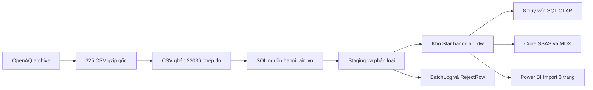
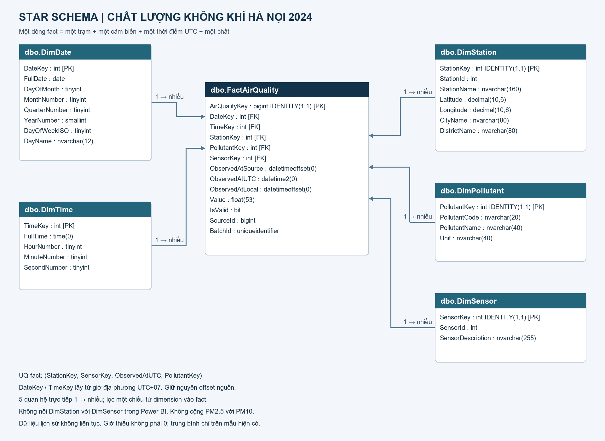
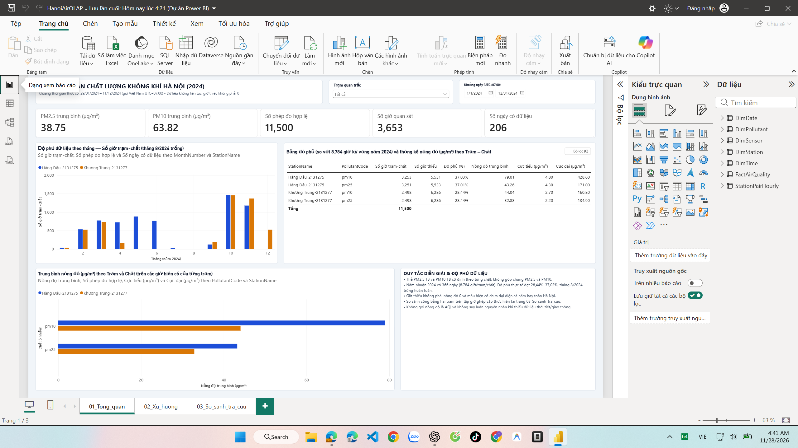

# Kho dữ liệu chất lượng không khí Hà Nội

Đồ án môn Kho dữ liệu của nhóm 5 sinh viên: xây dựng quy trình từ dữ liệu lịch sử OpenAQ đến kho SQL Server, ETL bằng SSIS, phân tích OLAP/SSAS và báo cáo Power BI. Phạm vi gồm **PM2.5 và PM10 tại Hàng Đậu, Khương Trung trong năm 2024**, tính theo giờ Việt Nam UTC+07:00.

**Bản chốt ngày 28/11/2026:** hoàn thiện sản phẩm và tài liệu của 16 bước. Repo giữ mã nguồn, dữ liệu chốt, project, sơ đồ, kiểm thử và minh chứng. Các giới hạn vận hành còn lại được công bố ở cuối README và trong biên bản nghiệm thu.

## Tài liệu và sản phẩm chính

| Nhu cầu | Tệp nên mở |
| --- | --- |
| Học hiểu toàn bộ đồ án | [Word 29 trang, 8 chặng học và 42 câu vấn đáp](report/san_pham/Huong_dan_hoc_hieu_do_an_khong_khi_Ha_Noi.docx) |
| Trình bày ngắn | [PowerPoint 9 slide chỉnh sửa được, có ghi chú thuyết trình](report/san_pham/Quy_trinh_do_an_khong_khi_Ha_Noi.pptx) |
| Dựng và chạy dự án | [Hướng dẫn chạy từ nguồn đến báo cáo](docs/huong_dan_chay.md) |
| Xem đánh giá các bước đã làm | [Rà soát bước 1–15](report/kiem_tra_buoc_1_den_15.md) |
| Đọc báo cáo tổng hợp | [Bước 16 với sáu phần tổng hợp](report/cac_phan/09_hoan_thien_buoc16.md) |
| Chuẩn bị demo | [Kịch bản 8–10 phút](report/kich_ban_demo.md) |
| Mở báo cáo Power BI để làm việc | [HanoiAirOLAP.pbip](dashboard/HanoiAirOLAP.pbip) |
| Mở bản báo cáo nhị phân đã lưu | [khong_khi_ha_noi.pbix](dashboard/khong_khi_ha_noi.pbix) |

Trên GitHub, dùng **Download raw file** để tải Word, PowerPoint hoặc PBIX về máy. Clone cả repository khi cần mở PBIP hoặc các project có nhiều tệp.

## Bài toán và phạm vi

Các câu hỏi phân tích gồm nồng độ theo ngày/tháng/giờ, số mẫu và độ phủ, chênh lệch hai trạm trên cùng tập giờ, và truy vết một chỉ số về phép đo nguồn.

- Trạm Hàng Đậu: OpenAQ location ID `2161299`.
- Trạm Khương Trung: OpenAQ location ID `2161301`.
- Chất phân tích: `pm25`, `pm10`, đơn vị µg/m³. CO/NO2 được giữ ở nguồn, ngoài kho chính.
- Phạm vi năm 2024 theo UTC+07; dữ liệu thực có từ 29/01 đến 11/12/2024, có nhiều khoảng thiếu.
- Giờ thiếu không được điền nồng độ 0. Không suy rộng mẫu quan sát thành toàn năm hoặc toàn Hà Nội.
- Nồng độ không phải AQI. Chưa kết luận vượt quy chuẩn hoặc nguyên nhân ô nhiễm khi thiếu phương pháp và dữ liệu bổ sung.

Chi tiết: [phạm vi](docs/pham_vi.md), [hồ sơ nguồn](data/README.md).

## Kiến trúc và quy trình



CSV được chuyển thành script SQL chứa dữ liệu và thực thi để tạo bảng nguồn. SSIS điều phối việc đọc SQL nguồn vào staging và gọi procedure nạp kho. Power BI **đọc trực tiếp SQL kho**, độc lập với cube SSAS.

Để học nhanh, 16 bước được gom thành 8 chặng:

| Chặng | Bước gốc | Đầu ra |
| --- | --- | --- |
| Phạm vi và môi trường | 1–2 | Câu hỏi, trạm/chất/năm, công cụ |
| Dữ liệu và SQL nguồn | 3–4 | Manifest, checksum, CSV, SQL và khảo sát chất lượng |
| Thiết kế đa chiều | 5 | Ba sơ đồ, grain, khóa và từ điển |
| Kho và staging | 6–7 | DDL, lịch, phân loại và reject |
| Nạp kho và SSIS | 8–10 | Procedure, package, log và kiểm thử nạp lại |
| OLAP và SSAS | 11 | SQL phân tích, cube và MDX |
| Power BI | 12–14 | Mô hình, DAX, ba trang, so sánh giờ chung |
| Nghiệm thu và bàn giao | 15–16 | Đối soát, hướng dẫn, Word, slide và demo |

## Dữ liệu và các mốc đối soát

OpenAQ phân phối dữ liệu quan trắc lịch sử. Danh mục trong [data/source](data/source/) ghi URL, metadata và hash; manifest xác định tập tệp của bản chốt. Ngày tải ban đầu chưa có bằng chứng đầy đủ và không được suy đoán từ ngày sửa tệp.

| Mốc | Kết quả |
| --- | ---: |
| Tệp `.csv.gz` gốc | 325 |
| Dòng nguồn và CSV ghép, gồm 4 chất | 23.036 |
| Fact PM2.5/PM10 hợp lệ | 11.500 |
| PM2.5 / PM10 | 5.749 / 5.751 |
| Trạm / cảm biến bụi | 2 / 4 |
| Lịch năm / mốc giờ trong ngày | 366 ngày / 24 giờ |
| Tệp được kiểm tra SHA-256 | 327/327 khớp |
| Giờ chung của hai trạm | 2.098 cho mỗi chất |

327 mục hash gồm 325 tệp gốc, CSV ghép và SQL nguồn. SHA-256 kiểm tra tính toàn vẹn byte, không chứng nhận hiệu chuẩn cảm biến. CSV có thể khác thứ tự dòng hoặc biểu diễn số mà vẫn cùng đa tập phép đo; công cụ đối soát kiểm tra cả nội dung.

## Mô hình dữ liệu

**Star là mô hình triển khai chính:** `FactAirQuality` cùng `DimDate`, `DimTime`, `DimStation`, `DimPollutant`, `DimSensor`; tổng 6 bảng, 40 cột và 5 quan hệ phân tích 1–n. Staging/log/reject là bảng hỗ trợ.

**Grain:** một phép đo của một chất, tại một trạm, một cảm biến, một thời điểm chính xác. Khóa chống trùng:

```sql
UNIQUE (StationKey, SensorKey, ObservedAtUTC, PollutantKey)
```

Giữ thời gian nguồn có offset, dùng UTC nhận diện thời điểm; `DateKey`/`TimeKey` lấy từ giờ Việt Nam. `SourceId` tham chiếu ID bảng SQL nguồn, `BatchId` tham chiếu lần ETL. Dimension mô tả cập nhật theo SCD Type 1. Các quan hệ Power BI lọc một chiều từ dimension vào fact.



| Lược đồ | Vai trò | Sản phẩm |
| --- | --- | --- |
| Star | Đã triển khai SQL/ETL/OLAP/Power BI | [draw.io](docs/thiet_ke/star_schema.drawio), [PNG](docs/thiet_ke/star_schema.png), [từ điển](docs/thiet_ke/tu_dien_du_lieu.md) |
| Snowflake | Học cách chuẩn hóa dimension, tách City và Unit | [draw.io](docs/thiet_ke/snowflake_schema.drawio), [PNG](docs/thiet_ke/snowflake_schema.png), [từ điển](docs/thiet_ke/tu_dien_snowflake_schema.md) |
| Galaxy | Học cách bổ sung fact độ phủ ngày dùng chung chiều | [draw.io](docs/thiet_ke/galaxy_schema.drawio), [PNG](docs/thiet_ke/galaxy_schema.png), [từ điển](docs/thiet_ke/tu_dien_galaxy_schema.md) |

Ba lược đồ dùng để học vẽ và so sánh; chỉ Star cần chạy SQL trong phạm vi đã chốt. Xem [so sánh và lý do chọn](docs/thiet_ke/so_sanh_ba_luoc_do.md).

## Công cụ cần có

| Thành phần | Vai trò |
| --- | --- |
| SQL Server Database Engine và SSMS/sqlcmd | Lưu nguồn/kho, thực thi T-SQL và kiểm tra |
| Visual Studio và Integration Services Projects | Mở, cấu hình và chạy package SSIS |
| OLE DB provider tương thích | Kết nối SSIS đến SQL Server |
| SSAS Multidimensional và Analysis Services Projects | Deploy/process cube, chạy MDX khi cần nhánh SSAS |
| Power BI Desktop hỗ trợ PBIP/PBIR | Refresh và xem ba trang báo cáo |
| Python 3 | Đọc gzip/CSV, đối soát và tạo SQL thực hành |
| Pillow, python-docx | Chỉ cần cho công cụ sinh sơ đồ hoặc tài liệu tương ứng |
| diagrams.net/draw.io | Chỉnh sửa sơ đồ thiết kế |

Các script kiểm tra nguồn/ghép CSV/sinh SQL dùng thư viện chuẩn Python. Phiên bản đã sử dụng và cách kiểm tra môi trường nằm tại [docs/moi_truong.md](docs/moi_truong.md). Máy mới phải kiểm tra quyền, driver, target version và kết nối trước khi chạy project.

## Bắt đầu từ một bản clone

```powershell
git clone https://github.com/thinhtran-18/hanoi-air-quality-dw.git
cd hanoi-air-quality-dw
python tools/doi_soat_nguon.py
```

Kỳ vọng đọc 325 tệp, 23.036 dòng, không có chênh lệch giữa nguồn gốc và CSV, `issues` rỗng. Không dùng `--write` khi chỉ kiểm tra vì tùy chọn này sinh lại hồ sơ/checksum.

Các thao tác dưới đây là thứ tự chạy, không phải cam kết máy mới đã có sẵn mọi driver. [Hướng dẫn chạy chi tiết](docs/huong_dan_chay.md) ghi cấu hình SSIS và kết quả mong đợi.

1. **Nạp SQL nguồn:** SSMS / File / Open / File / `sql/source/hanoi_air_quality_vn_monitoring_real.sql` / kiểm tra server, database / Execute. Kỳ vọng `hanoi_air_vn.dbo.air_quality_hourly` có 23.036 dòng. SQL đã chứa dữ liệu; không import thêm CSV.
2. **Dựng kho:** chạy theo thứ tự `sql/schema/01_tao_kho.sql`, `02_tao_staging.sql`, `03_tao_dimensions.sql`, `04_tao_fact.sql`, `05_nap_lich.sql`, `06_tao_views_buoc14.sql`. Có thể dùng `00_chay_buoc6_ssms.sql` thay 01–05, rồi chạy riêng 06. Chọn một cách.
3. **Cài ETL:** chạy `sql/etl/01_chuan_hoa.sql`, `02_nap_kho.sql`, `03_ssis_staging.sql` theo thứ tự. Chạy điều phối T-SQL sau khi DDL hoàn tất:

   ```sql
   USE hanoi_air_dw;
   DECLARE @BatchId uniqueidentifier;
   EXEC etl.usp_RunBatch @BatchId OUTPUT;
   SELECT COUNT_BIG(*) AS FactRows FROM dbo.FactAirQuality;
   SELECT TOP (5) * FROM etl.BatchLog ORDER BY StartedAtUTC DESC;
   ```

   Kho mới: lần đầu 11.500 mới; lần sau 0 mới/11.500 đã có. Kho đã nạp: chạy lại giữ 11.500 fact.
4. **Chạy SSIS:** mở `etl/HanoiAirETL/HanoiAirETL.slnx` / `00_RunAll.dtsx` / chỉnh `CN_Nguon`, `CN_Kho` / Test Connection / kiểm tra BatchId / Start / xem Progress và BatchLog. [Hướng dẫn từng ô cấu hình](docs/huong_dan_buoc_9_ssis.md).
5. **Đối soát:** chạy `sql/checks/kiem_tra_nguon.sql`, `kiem_tra_kho.sql`, `doi_soat_buoc10.sql`, `doi_soat_buoc14.sql`. Bộ thử ràng buộc yêu cầu kho trống chỉ dùng đúng thời điểm trước ETL.
6. **OLAP/SSAS:** chạy tám truy vấn trong `sql/olap/`. Nếu trình diễn cube, dùng project hoàn chỉnh `olap/HanoiAirCubeImported/HanoiAirCubeImported.dwproj`, cấu hình nguồn/quyền rồi Deploy / Process / chạy ba MDX. [Hướng dẫn SSAS](olap/README.md).
7. **Power BI:** mở `dashboard/HanoiAirOLAP.pbip` / Data source settings / sửa SQL server theo máy / Refresh / kiểm tra ba trang / Save. Cache và thiết lập `.pbi` không được phân phối, nên cần nạp lại dữ liệu. PBIP là bản làm việc; tránh sửa đồng thời PBIP và PBIX.

Script có `CREATE DATABASE`, `USE` và guard tên database cố định. Đổi dropdown SSMS hoặc truyền `sqlcmd -d` không đổi đích bên trong script. Khi thử database khác phải rà bản sao script và mọi tham chiếu trước khi Execute.

## Học lại bước tải và ghép CSV

Bộ nguồn chốt đã nằm trong repo. Các lệnh sau dành cho thực hành, ghi sang thư mục cục bộ riêng:

```powershell
python tools/tai_nguon_va_sql.py --out-dir .local/thuc_hanh/raw
python tools/kiem_tra_csv.py --raw-dir .local/thuc_hanh/raw --output .local/thuc_hanh/ghep.csv
python tools/tao_sql_server.py --csv .local/thuc_hanh/ghep.csv --output .local/thuc_hanh/nguon_moi.sql
```

Tên `tai_nguon_va_sql.py` giữ từ trước nhưng hiện chỉ tải tệp theo manifest. `kiem_tra_csv.py` đọc gzip bằng thư viện CSV, kiểm tra header và ghi tiêu đề một lần. `tao_sql_server.py` chỉ sinh SQL, chưa thực thi database; SQL sinh mới yêu cầu bảng nguồn chưa tồn tại, khác bản SQL chốt hỗ trợ nạp lại.

CSV mới có thể đổi thứ tự IDENTITY nguồn. **Không thay bảng nguồn bên dưới kho đã nạp bằng SQL thực hành.** Dùng SQL chốt khi dựng lại dự án; bài thực hành nguồn mới phải cô lập cả nguồn và kho để bảo vệ `SourceId`. Các lệnh từ chối ghi đè tệp đích đã có; chọn tên mới khi chạy lại. Chi tiết: [tools/HUONG_DAN.txt](tools/HUONG_DAN.txt).

## ETL và truy vết

Luồng SSIS: `StartBatch` / `Extract PM to Stage` / `ProcessStagedBatch`; Data Flow lỗi chuyển sang `FailStagedBatch`. BatchId đi cùng từng dòng staging. Procedure xử lý staging phân loại, nạp dimension trước fact trong transaction/application lock và ghi log.

- Cùng grain, cùng payload: chỉ nạp một lần.
- Cùng grain, payload khác: phát hiện xung đột, không tự ghi đè.
- Pipeline hiện tại reject NULL/âm trước fact; dòng accepted được nạp với `IsValid=1`.
- `IsValid` phản ánh quy tắc kỹ thuật, không chứng nhận chất lượng hiệu chuẩn.
- Giữ staging theo chính sách hiện tại để đối soát payload và truy vết lần chạy.

Đặc tả: [SQL ETL](sql/etl/README.md), [báo cáo nạp kho](report/cac_phan/05_nap_kho.md), [báo cáo SSIS](report/cac_phan/06_ssis_buoc9.md).

## Dashboard và kết quả phân tích

Mô hình Import có 7 bảng: 6 bảng Star và `StationPairHourly`, với 8 quan hệ, 19 measure nghiệp vụ. Một measure trống còn lại được ghi nhận trong bảng rà soát. Cube SSAS `Air Quality` có 5 chiều; Power BI lấy dữ liệu trực tiếp SQL.

1. **Tổng quan:** số mẫu, trung bình theo chất và độ phủ.
2. **Xu hướng:** ngày, tháng, giờ; thể hiện khoảng thiếu.
3. **So sánh và tra cứu:** giờ chung, chênh lệch hai trạm và phép đo nguồn.



Trung bình trên toàn bộ phép đo hợp lệ: PM2.5 **38,75**, PM10 **63,82 µg/m³**. Độ phủ theo từng trạm–chất trên 8.784 giờ kỳ vọng chỉ **28,44–37,03%**.

| Cùng 2.098 giờ/chất | Hàng Đậu | Khương Trung | Chênh lệch HĐ − KT |
| --- | ---: | ---: | ---: |
| PM2.5 (µg/m³) | 42,88 | 32,47 | +10,42 |
| PM10 (µg/m³) | 74,40 | 43,66 | +30,73 |

Chênh lệch được tính trước làm tròn nên có thể khác phép trừ hai số đã hiển thị. Trung bình trên giờ chung khác trung bình trên tập giờ riêng của từng trạm. Không SUM nồng độ, không gộp PM2.5 và PM10; trung bình tổng hợp cần đúng trọng số và bộ lọc. Xem [định nghĩa chỉ số](dashboard/dinh_nghia_chi_so.md) và [DAX](dashboard/measures.dax).

## Kiểm thử và minh chứng

| Nhóm | Kết quả và nơi tra |
| --- | --- |
| Nguồn | 327/327 checksum; CSV ghép lại cùng đa tập 23.036 phép đo; [biên bản nguồn](report/minh_chung/bien_ban_doi_soat_nguon.md) |
| Cấu trúc/kho | 6 bảng/40 cột, 366 ngày/24 giờ, 11.500 hợp lệ, 0 trùng grain, 0 FK mồ côi |
| ETL | [13 ca kiểm thử](report/minh_chung/ket_qua_etl.csv), có phân biệt kết quả lịch sử và giới hạn |
| SQL–DAX | [17 ca đối soát](dashboard/doi_soat_chi_so.csv); số đếm khớp, dung sai tuyệt đối 0,000001 µg/m³ |
| Tái lập T-SQL | Kho thử độc lập ở bước 15: 11.500 mới lần đầu, 0 mới lần hai; [nghiệm thu](report/cac_phan/08_nghiem_thu_buoc15.md) |
| Kiểm tra lại bước 16 | [Kết quả SQL/MCP/nguồn](report/minh_chung/buoc16_kiem_tra_hien_tai.json), [SQL](report/minh_chung/buoc16_sql_hien_tai.txt) |
| Word/PowerPoint | Đã xem đủ 29 trang/9 slide, 42 câu hỏi và chart native; [biên bản bàn giao](report/minh_chung/buoc16_bien_ban_ban_giao.json) |

Kiểm tra nguồn/SQL bằng dòng lệnh, truy vấn mô hình qua MCP và xem trực tiếp giao diện được phân biệt trong hồ sơ. Minh chứng lịch sử không đồng nghĩa toàn bộ package/cube đã được chạy lại ở bước 16. Tệp bàn giao ghi trạng thái tại lúc tạo; lịch sử Git ghi lần commit/push sau đó.

## Cấu trúc repository

```text
hanoi-air-quality-dw/
├── README.md                 Tổng quan và điểm vào tài liệu
├── LICENSE                   Giấy phép mã nguồn
├── docs/                     Phạm vi, môi trường, hướng dẫn chạy và SSIS
│   └── thiet_ke/             Ba sơ đồ draw.io/PNG, từ điển và so sánh
├── data/
│   ├── raw/                  325 CSV gzip gốc
│   ├── source/               CSV ghép, manifest và danh mục nguồn
│   └── checksums.sha256      Mã băm của bộ nguồn chốt
├── sql/
│   ├── source/               Tạo và nạp bảng SQL nguồn
│   ├── schema/               DDL kho, lịch và views ghép cặp
│   ├── etl/                  Chuẩn hóa, điều phối và nạp kho
│   ├── checks/               Kiểm tra và đối soát
│   └── olap/                 Tám truy vấn phân tích
├── etl/HanoiAirETL/          Solution/project/package SSIS
├── olap/                     SSAS, XMLA, MDX và hướng dẫn
│   └── HanoiAirCubeImported/ Project cube hoàn chỉnh
├── dashboard/               PBIP, PBIX, PBIR, TMDL, DAX và đối soát
├── tools/                   Công cụ Python chuẩn bị và kiểm tra
└── report/
    ├── cac_phan/            Báo cáo theo bước đến bước 16
    ├── san_pham/            Word học tập và PowerPoint trình bày
    └── minh_chung/          CSV, JSON, kết quả truy vấn và ảnh
```

`olap/HanoiAirCube/` là project khung giai đoạn đầu; dùng `HanoiAirCubeImported` để mở cube hoàn chỉnh. Các báo cáo theo bước lưu lịch sử triển khai; khi mô tả khác nhau, đọc cập nhật cuối, nghiệm thu bước 15 và rà soát bước 16.

## Giới hạn đã biết và hướng phát triển

- Dữ liệu gián đoạn, chỉ hai trạm; không đại diện liên tục cả năm/toàn thành phố và chưa đủ dữ liệu suy nguyên nhân.
- `Project.params` SSIS chưa tham số hóa đầy đủ; máy khác cần sửa Connection Manager. Tái lập kho trống đã kiểm chứng bằng T-SQL, chưa thử riêng package SSIS trỏ sang kho trống khác.
- Application lock SSIS bảo vệ xử lý staging, chưa bao Data Flow; không chạy package đồng thời. Còn hai batch Running cũ tại lúc kiểm tra, cần xác minh trước khi xử lý.
- Chi tiết reject/xung đột trong transaction lỗi có thể rollback; cần phát triển log bền vững và chính sách lưu staging, xử lý batch treo.
- SSAS còn một cảnh báo provider trong minh chứng build; PBIR phiên bản mới từng có giới hạn kiểm tra schema công khai.
- PBIX là bản nhị phân đã lưu; khi cần phiên bản mô hình làm việc mới nhất, mở PBIP và Refresh/Save. Không mặc định hai bản đã đồng bộ sau mọi chỉnh sửa.

Bản chốt hoàn thành phạm vi học tập và bàn giao đã mô tả, đồng thời giữ rõ các giới hạn. Các hướng trên là công việc mở rộng, không được trình bày thành kết quả đã kiểm chứng.

## Quản lý phiên bản và giấy phép

Giữ nguyên nguồn chốt; thay đổi nguồn cần đối soát lại và ghi lý do. Khi sửa mã, tạo nhánh theo công việc, chạy kiểm tra liên quan và mở PR với mô tả thay đổi/kết quả. Word, PowerPoint và PBIX nên có một người chỉnh tại một thời điểm.

Cấu hình cá nhân, cache `.pbi`, thư mục `.local`, `.vs`, `bin`, `obj`, tệp database/backup và thông tin đăng nhập được loại khỏi bản theo dõi theo `.gitignore`. Không lưu mật khẩu/token trong project. Việc bỏ theo dõi ở bản chốt không xóa các tệp khỏi máy và không viết lại lịch sử Git cũ.

Mã nguồn sử dụng [MIT License](LICENSE). Dữ liệu được dẫn nguồn OpenAQ và bên cung cấp theo [hồ sơ nguồn](data/README.md); giấy phép mã nguồn không thay thế điều kiện sử dụng dữ liệu của nguồn.
