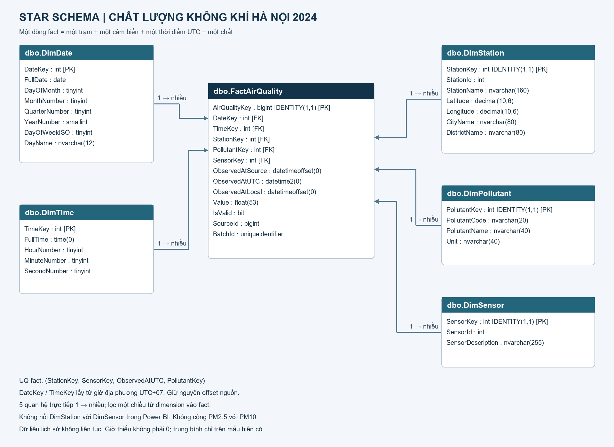
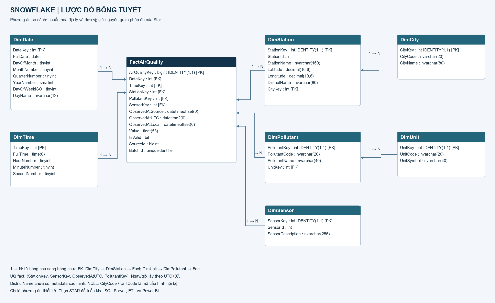
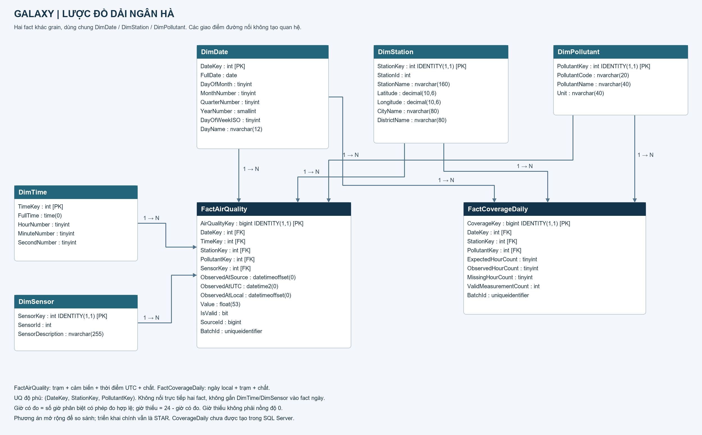

# Bước 5 mở rộng — Hình sao, bông tuyết và dải ngân hà

Ngày cập nhật: 27/11/2026. Theo yêu cầu bổ sung của giảng viên, đồ án trình bày cả ba loại lược đồ. **Chọn Star Schema để triển khai chính trong SQL Server, ETL, OLAP và Power BI.** Snowflake và Galaxy là hai phương án thiết kế để so sánh, chưa tạo bảng vật lý hay package ETL cho hai phương án này.

Các mô hình là **phương án thay thế hoặc mở rộng**, không phải yêu cầu tạo tất cả bảng của ba sơ đồ trong cùng schema dbo. Các tên bảng trùng nhau thể hiện cùng vai trò nghiệp vụ trong mỗi phương án.

## 1. Hình sao — mô hình được chọn

Một fact `FactAirQuality`, 5 dimension trực tiếp: DimDate, DimTime, DimStation, DimPollutant, DimSensor. Có 6 bảng, 40 cột, 5 quan hệ 1–n. Grain một phép đo theo trạm–cảm biến–thời điểm–chất. Khóa chống trùng `(StationKey, SensorKey, ObservedAtUTC, PollutantKey)`.

Đặc tả và từ điển chính vẫn là [thiet_ke_star_schema.md](thiet_ke_star_schema.md) và [tu_dien_du_lieu.md](tu_dien_du_lieu.md). Dùng chúng khi viết DDL/ETL bước tiếp theo.

## 2. Bông tuyết — chuẩn hóa dimension

Sơ đồ: [draw.io](snowflake_schema.drawio). Từ điển đầy đủ: [tu_dien_snowflake_schema.md](tu_dien_snowflake_schema.md). Phương án có **8 bảng, 46 cột, 7 quan hệ**, gồm 1 fact và 7 dimension.

Giữ nguyên grain, cột và unique của FactAirQuality. Chuẩn hóa hai nhánh dimension của Star:

| Thay đổi | Quan hệ 1–n | Ràng buộc |
| --- | --- | --- |
| Chuyển CityName từ DimStation sang DimCity; DimStation giữ CityKey | DimCity.CityKey → DimStation.CityKey | CityKey là PK của DimCity và FK NOT NULL của DimStation; CityCode duy nhất |
| Chuyển Unit từ DimPollutant sang DimUnit; DimPollutant giữ UnitKey | DimUnit.UnitKey → DimPollutant.UnitKey | UnitKey là PK của DimUnit và FK NOT NULL của DimPollutant; UnitCode và UnitSymbol duy nhất |

Năm quan hệ dimension → fact còn lại giữ như Star. Hướng lọc nếu dựng mô hình này là từ bảng cha xuống bảng con rồi vào fact. Không tạo cạnh DimCity → fact, DimUnit → fact, DimStation → DimSensor hoặc đường lọc hai chiều bổ sung.

`CityCode=HAN` và `UnitCode=UG_M3` là **mã cấu hình nội bộ**, không phải mã hành chính hoặc mã từ OpenAQ. CityName=Hà Nội lấy từ phạm vi đề tài; UnitSymbol=µg/m³ đối chiếu đơn vị nguồn. Hai trạm cùng tham chiếu một thành phố; hai chất cùng tham chiếu một đơn vị. Không tạo quận/huyện giả: DistrictName vẫn NULL khi thiếu metadata xác minh. DimDate chưa cần tách thành bảng tháng/quý/năm; chuẩn hóa các nhánh địa lý và đơn vị đã thể hiện cấu trúc bông tuyết.

Natural key của trạm, cảm biến, chất vẫn duy nhất trong phạm vi OpenAQ. Unit của mỗi PollutantCode phải thống nhất; dữ liệu khác đơn vị cần quy tắc chuyển đổi trước khi nạp. Các quy tắc UTC/local, chất lượng, SCD Type 1 và xử lý xung đột của Star vẫn áp dụng cho phương án này.

Lợi ích thiết kế: metadata thành phố và đơn vị quản lý tại một bảng. Đổi lại phải nối qua thêm bảng khi phân tích thành phố hoặc đơn vị. Với chỉ hai trạm, một thành phố và một đơn vị, lợi ích giảm lặp nhỏ, trong khi việc triển khai thêm bảng và lookup không cần thiết cho phạm vi hiện tại.

## 3. Dải ngân hà — hai fact dùng chung dimension

Sơ đồ: [draw.io](galaxy_schema.drawio). Từ điển đầy đủ: [tu_dien_galaxy_schema.md](tu_dien_galaxy_schema.md). Phương án có **7 bảng, 49 cột, 8 quan hệ**, gồm 2 fact và 5 dimension.

| Fact | Grain | Khóa duy nhất | Nội dung |
| --- | --- | --- | --- |
| FactAirQuality | Một trạm–cảm biến–thời điểm UTC–chất | StationKey, SensorKey, ObservedAtUTC, PollutantKey | Nồng độ và trạng thái hợp lệ của phép đo |
| FactCoverageDaily | Một ngày local–trạm–chất | DateKey, StationKey, PollutantKey | Số giờ lịch, số giờ có đo, số giờ thiếu và số phép đo hợp lệ |

DimDate, DimStation, DimPollutant là **dimension dùng chung**: cùng surrogate key, cùng ý nghĩa và cùng quy tắc cập nhật cho cả hai fact. DimTime và DimSensor chỉ nối FactAirQuality vì fact ngày không có grain giờ/cảm biến. Không thêm sensor hoặc time key giả vào fact ngày. Không nối trực tiếp hai fact. Các giao điểm đường nối trên PNG không biểu thị một quan hệ mới.

FactCoverageDaily là **periodic snapshot theo ngày**, tính từ các phép đo của cùng nguồn OpenAQ kết hợp lịch. Mô hình này minh họa một fact về quan sát và một fact về độ phủ; không đòi hỏi giả lập nguồn thời tiết hoặc giao thông. Đây là fact dẫn xuất, không phải bằng chứng đo độc lập.

### Quy tắc fact độ phủ

- Lịch năm 2024 đủ 366 ngày địa phương UTC+07, 2 trạm, 2 chất: **1.464 dòng dự kiến**. Tạo đủ tổ hợp từ lịch × trạm × chất, sau đó LEFT JOIN số liệu đã tổng hợp.
- ExpectedHourCount=24 cho mỗi tổ hợp ngày–trạm–chất. Đây là mẫu số lịch theo phạm vi, không xác nhận trạm bắt buộc vận hành 24 giờ/ngày. Mỗi trạm–chất có 8.784 giờ lịch trong năm.
- ObservedHourCount đếm **giờ địa phương phân biệt có ít nhất một fact IsValid=1**, không đếm số cảm biến hoặc số dòng. Với nguồn có phút/giây, chỉ cắt về giờ để tính độ phủ; khóa fact chi tiết vẫn giữ thời điểm chính xác.
- ValidMeasurementCount đếm số phép đo IsValid=1 của ngày–trạm–chất. Với nhiều cảm biến trong cùng giờ, số phép đo có thể lớn hơn số giờ có dữ liệu.
- MissingHourCount=ExpectedHourCount−ObservedHourCount là **cột tính toán**, không cần ETL nhập riêng. Ràng buộc `0 <= ObservedHourCount <= ExpectedHourCount = 24`; `ValidMeasurementCount >= ObservedHourCount`.
- Ngày không có quan sát có ObservedHourCount=0, ValidMeasurementCount=0, MissingHourCount=24. Các số 0 này nói về **số lượng quan sát**, không phải nồng độ bằng 0.
- Tỷ lệ độ phủ tính khi truy vấn: `100.0 * SUM(ObservedHourCount) / NULLIF(SUM(ExpectedHourCount), 0)`. Không cộng phần trăm, không lấy trung bình tỷ lệ với các mẫu số khác nhau.
- BatchId lưu lần tính lại độ phủ. Nếu triển khai sau này, upsert theo unique ngày–trạm–chất và tính lại ngày bị ảnh hưởng khi dữ liệu/IsValid thay đổi; không chèn thêm dòng chỉ vì BatchId mới. Nhật ký cần ghi nguồn/hash, chính sách kiểm tra hợp lệ và lô đầu vào.
- Không join fact chi tiết với fact ngày rồi SUM các chỉ tiêu ngày vì sẽ nhân số giờ theo số dòng chi tiết. Tổng hợp từng fact về cùng grain trước khi so sánh hoặc dùng các measure riêng qua dimension chung. Bộ lọc cảm biến/giờ không áp dụng trực tiếp cho fact độ phủ ngày và phải được ghi rõ khi thiết kế báo cáo.

### Minh chứng tính thử trên dữ liệu hiện tại

Script tạo `report/minh_chung/buoc5_galaxy_do_phu_ngay.csv` từ CSV nguồn. Tệp dùng LocalDate, StationId, PollutantCode để đối chiếu, **không giả định surrogate key của kho chưa được tạo**, và không phải fact đã nạp SQL. Quy tắc hợp lệ kỹ thuật được áp dụng theo đặc tả; bộ hiện tại không có số âm, thiếu giá trị hoặc đơn vị sai trong phạm vi.

| Trạm | Chất | Giờ có dữ liệu hợp lệ | Giờ lịch | Giờ thiếu |
| --- | --- | ---: | ---: | ---: |
| Hàng Đậu | PM2.5 | 3.251 | 8.784 | 5.533 |
| Hàng Đậu | PM10 | 3.253 | 8.784 | 5.531 |
| Khương Trung | PM2.5 | 2.498 | 8.784 | 6.286 |
| Khương Trung | PM10 | 2.498 | 8.784 | 6.286 |

Các tổng khớp bước 4. Không suy ra độ phủ toàn Hà Nội, tình trạng hoạt động thực tế hoặc mức đại diện cả năm từ các số liệu này.

## 4. So sánh và quyết định triển khai

| Tiêu chí | Hình sao | Bông tuyết | Dải ngân hà |
| --- | --- | --- | --- |
| Fact | 1 fact phép đo | 1 fact phép đo | 1 fact phép đo + 1 fact độ phủ ngày |
| Dimension | 5 chiều trực tiếp | 7 chiều, có nhánh chuẩn hóa | 5 chiều, 3 chiều dùng chung |
| Số bảng / quan hệ trong thiết kế này | 6 / 5 | 8 / 7 | 7 / 8 |
| Cấu trúc truy vấn | Dimension nối thẳng vào fact | Có thêm nối bảng thành phố/đơn vị | Phải chú ý hai grain khác nhau |
| Công việc ETL thêm | Tra 5 chiều, nạp fact | Nạp thêm City/Unit, lookup theo thứ tự | Tính snapshot đầy đủ, cập nhật lại khi dữ liệu đổi |
| Phù hợp phạm vi hiện tại | Đáp ứng phân tích PM2.5/PM10 ở hai trạm | Minh họa chuẩn hóa, lợi ích nhỏ với bộ nhỏ | Hữu ích nếu lưu độ phủ thành sản phẩm riêng |
| Vai trò trong đồ án | **Triển khai chính** | Vẽ và so sánh | Vẽ và so sánh, hướng mở rộng |

Chọn Star vì cấu trúc trực tiếp, đủ giữ grain nguồn và phù hợp việc dựng mô hình Power BI cho hai chất/hai trạm. Độ phủ vẫn có thể tính bằng truy vấn hoặc measure từ fact chi tiết và lịch, không bắt buộc bổ sung fact thứ hai ở giai đoạn này. Không khẳng định mô hình nào luôn nhanh hơn khi chưa có đo kiểm workload cụ thể.

## 5. Kiểm tra và tái lập

Chạy `python tools/tao_luoc_do_bo_sung.py` từ thư mục repo (cần Pillow và font Arial trên Windows). Script tạo hai bản draw.io, hai PNG, hai từ điển phương án, CSV tính thử độ phủ và `report/minh_chung/buoc5_kiem_tra_ba_luoc_do.json`.

- Cùng danh sách cột và tọa độ dùng cho PNG, draw.io và từ điển của mỗi phương án.
- Kiểm tra từng cạnh có FK tương ứng, số bảng/cột/cạnh, chiều rộng và chiều cao vùng chữ.
- Đã mở hai PNG kiểm tra trực quan. Draw.io được kiểm tra XML, chưa kiểm tra thao tác tương tác trong diagrams.net.
- Đối soát 1.464 dòng độ phủ, tổng 11.500 phép đo hợp lệ và tổng giờ theo từng trạm/chất với kết quả bước 4.
- Không thay đổi bảng SQL nguồn, sơ đồ Star hoặc từ điển triển khai chính.

**Bước 5 mở rộng hoàn thành** khi có đủ ba sơ đồ và bản chỉnh sửa, mô tả grain/khóa/quan hệ của hai phương án bổ sung, so sánh và quyết định chọn Star. Các sản phẩm trong thư mục này đáp ứng các điều kiện đó; chưa triển khai vật lý cả ba mô hình.
