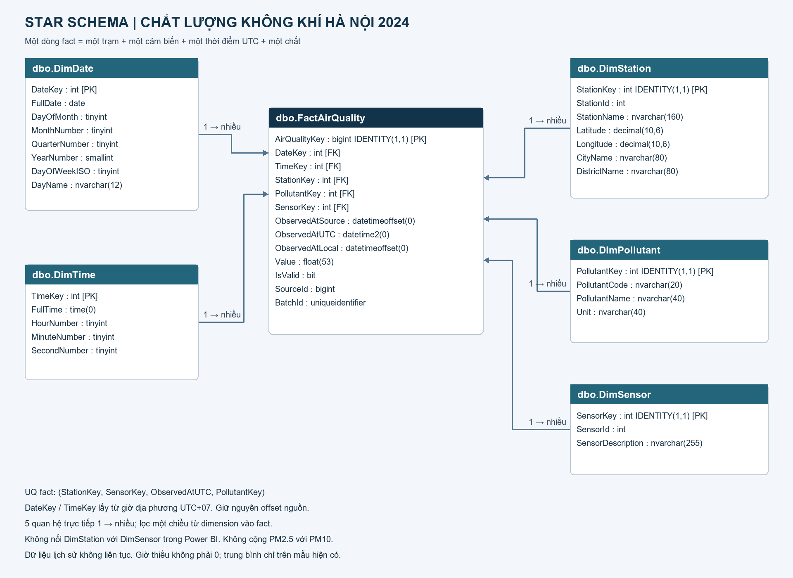

# Bước 5 — Thiết kế Star Schema

Ngày hoàn thành thiết kế: 27/11/2026. Đầu vào: phạm vi và khảo sát bước 1–4 tại commit `6a71786`; yêu cầu bước 5 trong kế hoạch và ảnh người dùng cung cấp. Tài liệu này chốt thiết kế để bước 6 tạo bảng kho và bước 7 triển khai ETL. Chưa tạo database kho, chưa nạp fact, chưa dựng mô hình Power BI.

## 1. Phạm vi và grain

Một dòng `dbo.FactAirQuality` là **một phép đo của một chất, tại một trạm, một cảm biến, một thời điểm chính xác**. Không gộp các cảm biến, không cắt timestamp thành giờ khi tạo khóa. Nguồn hiện tại có các mốc đầu giờ nên vẫn biểu diễn đủ bằng độ chính xác giây; nguồn tương lai có phần giây phải nâng độ chính xác trước khi nạp.

- Lọc năm **2024 theo giờ địa phương UTC+07:00**, chất `pm25`/`pm10`, trạm `2161299`/`2161301`. SQL nguồn vẫn giữ cả CO/NO2.
- Quy mô dự kiến từ bản nguồn hiện tại: **11.500 fact**, 2 trạm, 2 chất, 4 cảm biến. Đây là số dự kiến, chưa phải số dòng đã nạp kho.
- Khóa tự nhiên phép đo: `(location_id, sensor_id, thời điểm UTC, parameter)`.
- Khóa duy nhất bắt buộc ở fact: **`UNIQUE (StationKey, SensorKey, ObservedAtUTC, PollutantKey)`**. `AirQualityKey` là PK kỹ thuật riêng. Không đưa Value, SourceId hoặc BatchId vào khóa chống trùng.
- StationKey, SensorKey, PollutantKey là surrogate key sinh bởi kho; StationId, SensorId, PollutantCode là natural key nguồn. DateKey/TimeKey là khóa lịch có ý nghĩa, không phải IDENTITY.
- Phạm vi một nhà cung cấp OpenAQ; StationId và SensorId được tra duy nhất trong phạm vi nguồn này. Nếu hợp nhất nguồn khác phải bổ sung mã hệ thống nguồn vào natural key và quy tắc tra dimension trước khi nạp.

## 2. Bảng và quan hệ



| Bảng chiều | PK | FK ở fact | Quan hệ / hướng lọc Power BI |
| --- | --- | --- | --- |
| dbo.DimDate | DateKey | DateKey | 1 → nhiều, dimension → fact |
| dbo.DimTime | TimeKey | TimeKey | 1 → nhiều, dimension → fact |
| dbo.DimStation | StationKey | StationKey | 1 → nhiều, dimension → fact |
| dbo.DimPollutant | PollutantKey | PollutantKey | 1 → nhiều, dimension → fact |
| dbo.DimSensor | SensorKey | SensorKey | 1 → nhiều, dimension → fact |

Không tạo quan hệ DimStation–DimSensor hoặc DimSensor–DimPollutant trong mô hình phân tích. Cả ba chiều lọc trực tiếp vào fact. ETL kiểm tra tổ hợp trạm–cảm biến–chất theo metadata nguồn để tránh tra nhầm; kiểm tra này không đòi hỏi tạo thêm đường lọc Power BI. Không dùng lọc hai chiều mặc định. Không xóa dây chuyền dimension có fact tham chiếu.

Lịch cần đủ **366 ngày** từ 01/01 đến 31/12/2024 và **24 mốc giờ** từ 00:00:00 đến 23:00:00. Lịch đủ không có nghĩa tự tạo fact cho giờ thiếu. Nếu sau này có đo ở phút/giây khác 0, phải mở rộng DimTime trước; không làm tròn mất thời điểm đo.

## 3. Thời gian và truy vết

```sql
-- Biểu thức thiết kế; không thực thi thay đổi bảng.
ObservedAtSource = observed_at
ObservedAtUTC    = CAST(SWITCHOFFSET(observed_at, '+00:00') AS datetime2(0))
ObservedAtLocal  = SWITCHOFFSET(observed_at, '+07:00')
DateKey = YEAR(ObservedAtLocal)*10000 + MONTH(ObservedAtLocal)*100 + DAY(ObservedAtLocal)
TimeKey = DATEPART(hour, ObservedAtLocal)*10000
        + DATEPART(minute, ObservedAtLocal)*100 + DATEPART(second, ObservedAtLocal)
```

Ba timestamp phải cùng một thời điểm. ObservedAtUTC là datetime2 theo quy ước UTC; ObservedAtLocal là datetimeoffset bắt buộc +07:00. Không dùng CAST trực tiếp timestamp nguồn sang datetime2 để giả định đó là UTC. Ví dụ 30/01/2024 00:00+07 = 29/01/2024 17:00Z: DateKey phải là **20240130**, TimeKey = **0**. Khi hiển thị TimeKey dạng HHMMSS cần đệm số 0, nhưng khóa lưu kiểu int.

`SourceId` lấy từ `hanoi_air_vn.dbo.air_quality_hourly.id`, chỉ duy nhất và có ý nghĩa trong bảng nguồn hiện hành; không phải số thứ tự dòng CSV hay mã trạm. Không đặt FK liên database từ kho đến nguồn. Nếu tạo lại nguồn làm ID thay đổi, phải đối soát theo khóa tự nhiên và ghi lại lineage có kiểm soát. CSV không có id nên luồng chính nạp qua bảng SQL nguồn đã đối soát.

`BatchId` là UUID của lần chạy ETL, dùng truy vết nhật ký lần nạp ở bước triển khai. Không phải chiều phân tích, không phải khóa chống trùng; metadata lô sau này cần ghi thời gian chạy, tệp/hash đầu vào và số dòng nhận/loại. Nạp lại cùng phép đo không sinh fact mới dù BatchId mới.

## 4. Kiểu, chất lượng và cập nhật

Từ điển cột đầy đủ nằm ở [tu_dien_du_lieu.md](tu_dien_du_lieu.md), bản Excel có thể mở tại [tu_dien_du_lieu.csv](tu_dien_du_lieu.csv). Cả sơ đồ và từ điển sinh từ cùng danh sách cột trong `tools/tao_thiet_ke_buoc5.py`.

- `Value` dùng float(53) theo bảng nguồn để bảo toàn giá trị đang lưu, cho NULL để giữ bản ghi lỗi giá trị nếu các khóa/thời điểm vẫn xác định được. Khi đối soát số thực dùng dung sai như bước 4; chỉ làm tròn lúc hiển thị.
- `IsValid=1` khi giá trị khác NULL, không âm, đơn vị đúng µg/m³, đúng phạm vi, tra được các chiều và thời điểm hợp lệ. `IsValid=0` cho giá trị NULL/âm nhưng vẫn xác định được đầy đủ grain và đơn vị. NULL vẫn là NULL; số âm giữ nguyên để truy vết, không đổi thành 0.
- Sai định dạng thời gian, thiếu mã trạm/cảm biến/chất, đơn vị khác hoặc không tra được chiều: đưa vùng lỗi kèm lý do ở ETL, không ép vào fact. Ngoài phạm vi: ghi đếm loại theo phạm vi, không gán là phép đo lỗi.
- Giá trị cao không tự bị gắn IsValid=0. Cờ này thể hiện kiểm tra kỹ thuật, chưa chứng minh hiệu chuẩn hay độ đúng thực tế.
- Trùng grain và cùng payload: nạp một lần; nạp lại bỏ qua có đếm. Trùng grain nhưng khác giá trị hoặc metadata: báo xung đột, đưa vùng đối soát, không chọn ngẫu nhiên hay tự ghi đè. Unique constraint là chốt bảo vệ cuối.
- Dimension mô tả dùng **SCD Type 1**: giữ surrogate key theo natural key, chỉ cập nhật thuộc tính khi có metadata xác minh. Không thay tọa độ/tên đã biết bằng NULL/rỗng; log cũ/mới, thời điểm, nguồn và BatchId khi cập nhật. Không cần ValidFrom/ValidTo hoặc SCD Type 2 cho bộ lịch sử cố định này.
- DistrictName hiện NULL vì nguồn không có địa bàn xác minh. Không suy địa bàn từ tên trạm. Unit theo PollutantCode phải duy nhất; đơn vị mới phải chuẩn hóa bằng quy tắc đã chốt trước khi nạp.
- Mọi FK fact NOT NULL; kiểm tra hợp lệ trước khi nạp, không dùng khóa giả 0 để che lỗi tra dimension. `Value` và metadata mô tả có NULL theo từ điển.

## 5. Quy tắc phân tích

Trạm, chất, cảm biến và thời gian là chiều lọc/nhóm; Value là measure nồng độ. Dùng COUNT phép đo hợp lệ, AVG/MIN/MAX theo **từng chất và đơn vị**. Không dùng SUM nồng độ theo thời gian và không cộng PM2.5 với PM10 thành tổng. Không lấy trung bình các trung bình mà thiếu trọng số; lưu tổng và số mẫu nếu thiết kế bảng tổng hợp sau này.

Khi mở rộng nhiều cảm biến cùng trạm/chất/giờ, fact vẫn giữ từng phép đo; trước phân tích cấp trạm–giờ phải chốt quy tắc gộp cảm biến để không làm giờ có nhiều cảm biến nhận trọng số lớn hơn. Độ phủ đếm **giờ phân biệt trạm–chất**, không lấy số dòng fact chia 8.784. So sánh hai trạm dùng cùng chất và tập giờ ghép cặp, công bố số mẫu.

Đây là dữ liệu lịch sử **không liên tục**, độ phủ hiện tại khoảng 28–37% giờ năm 2024. Giờ thiếu không phải 0. Các thống kê chỉ mô tả mẫu hiện có, không mặc định đại diện cả năm, toàn Hà Nội hoặc chất lượng hoạt động hiện tại của trạm. Chưa tính AQI hay kết luận vượt chuẩn ở bước này.

## 6. Vì sao một giờ có nhiều dòng nhưng không trùng?

Một giờ chỉ là một phần grain. Ví dụ **29/01/2024 14:00+07:00** có bốn phép đo bụi thực tế:

| StationId | Trạm | SensorId | Chất | Value (µg/m³) |
| --- | --- | --- | --- | ---: |
| 2161299 | Hàng Đậu | 7771996 | pm25 | 57,8 |
| 2161299 | Hàng Đậu | 7772005 | pm10 | 145,7 |
| 2161301 | Khương Trung | 7772073 | pm25 | 40,6 |
| 2161301 | Khương Trung | 7772039 | pm10 | 53,0 |

Cùng giờ nhưng khác trạm, cảm biến hoặc chất nên khác khóa phép đo. Trùng chỉ khi **đồng thời cùng trạm, cùng cảm biến, cùng thời điểm UTC chính xác, cùng chất**. Khi cùng khóa nhưng khác Value, đó là xung đột dữ liệu cần đối soát, không phải hai phép đo độc lập. Khi mở rộng, ngay cả cùng trạm/chất/giờ cũng có thể có nhiều dòng hợp lệ do khác cảm biến hoặc khác phút/giây.

## 7. Minh chứng và điều kiện hoàn thành

| Điều kiện bước 5 | Kết quả | Minh chứng |
| --- | --- | --- |
| Chốt grain trạm–cảm biến–thời điểm–chất | Đạt | Mục 1 |
| Có sơ đồ chỉnh sửa được và PNG, 5 chiều nối trực tiếp 1–n | Đạt | star_schema.drawio, star_schema.png |
| Có từ điển bảng/cột/kiểu/NULL/khóa/ý nghĩa/nguồn | Đạt | tu_dien_du_lieu.md và .csv; 40 cột / 6 bảng |
| Sơ đồ và từ điển thống nhất | Đạt | Sinh từ một đặc tả, script kiểm tra cột và 5 cạnh |
| Unique đủ StationKey, SensorKey, ObservedAtUTC, PollutantKey | Đạt ở thiết kế | Mục 1 và từ điển; constraint thực thi ở bước 6 |
| Giữ offset nguồn, UTC định danh, DateKey/TimeKey theo local | Đạt | Mục 3; minh chứng ca nửa đêm |
| Giải thích một giờ nhiều dòng không trùng | Đạt | Mục 6; kiểm tra CSV và SQL nguồn |

Tái lập: `python tools/tao_thiet_ke_buoc5.py` (cần Pillow và font Arial trên Windows); script tạo lại sơ đồ, từ điển và JSON minh chứng từ CSV, không sửa nguồn. PNG là bản kết xuất bằng Pillow từ cùng cột/bố cục với draw.io; không đòi cài ứng dụng draw.io. Mở file draw.io bằng diagrams.net để chỉnh tiếp; nếu sửa đặc tả, chạy lại script để đồng bộ các sản phẩm.

Chạy `sqlcmd -S localhost -E -C -d hanoi_air_vn -i sql/checks/kiem_tra_grain_buoc5.sql` để kiểm tra độc lập bảng nguồn ở chế độ chỉ đọc. Kết quả lưu tại `report/minh_chung/buoc5_sql_grain.txt`; CSV và SQL đều xác nhận 11.500 dòng phạm vi và 0 dòng dư do trùng grain. Đây là kiểm tra thiết kế với dữ liệu đầu vào, chưa thay cho kiểm tra unique/FK trên kho sau khi triển khai.
