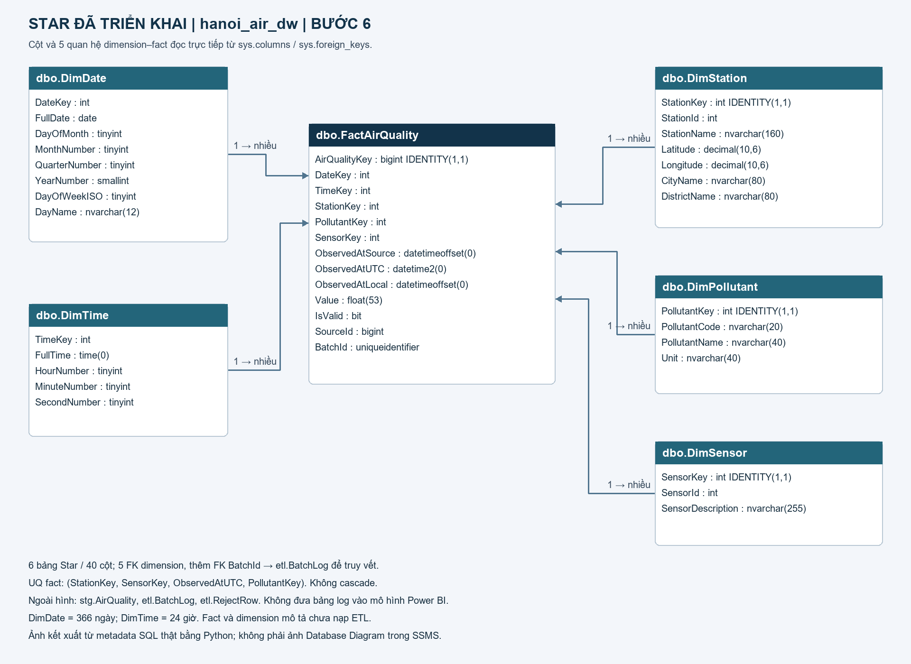

# Bước 6 — Triển khai cấu trúc kho Star

Ngày thực hiện: 27/11/2026. Đã tạo và chạy các script `sql/schema/01`–`05` trong Microsoft SQL Server Management Studio; sau đó kiểm tra cấu trúc kho hiện tại bằng sqlcmd/Python. Chưa kiểm chứng độc lập việc dựng lại trên database trống; hai ảnh SSMS từng được nhắc đến chưa có trong repo. Mô hình chính vẫn là Star đã chọn ở bước 5. Snowflake/Galaxy giữ ở mức phương án thiết kế.

## Kết quả đã thực thi và kiểm chứng

| Nội dung | Kết quả |
| --- | --- |
| Database kho | `hanoi_air_dw`, tách khỏi nguồn |
| Star | 6 bảng, 40 cột; tên/kiểu/NULL/IDENTITY đều khớp từ điển bước 5 |
| Hỗ trợ | `stg.AirQuality`, `etl.BatchLog`, `etl.RejectRow`; tổng 9 bảng nghiệp vụ/hỗ trợ |
| Khóa và CHECK | 9 PK, 6 UNIQUE, 8 FK, 26 CHECK; enabled/trusted, không cascade |
| Grain | UNIQUE (StationKey, SensorKey, ObservedAtUTC, PollutantKey) |
| Quan hệ | 5 dimension nối trực tiếp fact; thêm FK BatchId phục vụ lineage |
| Lịch | 366 ngày 01/01–31/12/2024, có 29/02; 24 mốc 00:00–23:00 |
| Chạy lại DDL/lịch | Thành công trong SSMS; không thêm trùng lịch |
| Ca thử kỹ thuật | 30/30 đạt; dữ liệu thử đều rollback |
| Nguồn sau thực hiện | 23.036 dòng, 11.500 dòng PM; không sửa bảng nguồn |
| Sơ đồ trong phần mềm | Đã lưu Database Diagram `Star_Buoc6`, đủ 6 bảng/5 quan hệ, giữ SSMS mở để xem |

Staging, log/reject, ba dimension mô tả và fact đều **0 dòng** sau kiểm tra. 11.500 là số phép đo PM ở nguồn, chưa phải số fact đã nạp. Bộ thử xác nhận cùng giờ khác cảm biến được phép, cùng grain dù đổi BatchId/Value vẫn bị chặn, đủ 5 FK chiều và FK batch, DateKey local/UTC đúng, NULL/âm chỉ được giữ với cờ 0 và số cao không tự bị loại. IDENTITY có thể có khoảng trống do transaction thử; không cam kết khóa bắt đầu từ 1 khi ETL.

## Sản phẩm và tái lập

- `sql/schema/README.md`: thứ tự chạy, cấu trúc staging/log/reject và giới hạn.
- `sql/checks/kiem_tra_cau_truc_buoc6.sql`: kiểm tra metadata/lịch chỉ đọc.
- `sql/checks/thu_rang_buoc_buoc6.sql`: ca thử transaction/rollback, chỉ dùng khi kho chưa nạp ETL.
- `tools/kiem_tra_buoc6.py`: đối chiếu từ điển với metadata thật và xuất minh chứng.
- `report/minh_chung/buoc6_kiem_tra_cau_truc.json`, `buoc6_thu_rang_buoc.csv`: kết quả máy đọc được.
- `report/minh_chung/buoc6_star_thuc_te.png`: sơ đồ kết xuất từ metadata SQL thật, đối chiếu đủ 40 cột và 5 cạnh Star; không phải ảnh giao diện Database Diagram.
- Ảnh Database Diagram và kết quả trong giao diện SSMS hiện chưa có trong repo; cần bổ sung và rà soát thông tin cá nhân trước khi công khai.

SSMS tự tạo `dbo.sysdiagrams` và các đối tượng hỗ trợ khi bật Database Diagrams. Đây là metadata của công cụ, không phải bảng nghiệp vụ hay dimension; số 9 PK/6 UQ trong báo cáo chỉ tính 9 bảng Star/hỗ trợ ETL, loại trừ `sysdiagrams`. Sơ đồ lưu trong database hiện tại; khi dựng kho mới có thể tạo lại qua SSMS hoặc dùng bản PNG kết xuất metadata. File tổng hợp để Execute trực tiếp là `sql/schema/00_chay_buoc6_ssms.sql`, sinh từ 01–05 và SQL kiểm tra; toàn bộ file bàn giao nằm trong project.

## Giới hạn và việc tiếp theo

Chưa có procedure chuẩn hóa/nạp kho, chưa đưa 11.500 phép đo vào fact, chưa có package SSIS, OLAP hoặc dashboard. Bước 7 tiếp tục chuẩn hóa staging và phân loại dữ liệu, bước 8 viết logic nạp/chạy lại. SSIS chưa xác nhận hoạt động; xử lý trước bước 9. Không thay giờ thiếu bằng nồng độ 0, không cộng PM2.5 và PM10 hay mặc định mẫu đại diện toàn năm/toàn Hà Nội.

Bước 6 không yêu cầu nạp phép đo; fact còn trống là trạng thái đúng trước ETL. Cần bổ sung ảnh SSMS và kiểm thử dựng kho trên database trống tách biệt để đủ minh chứng bàn giao.
